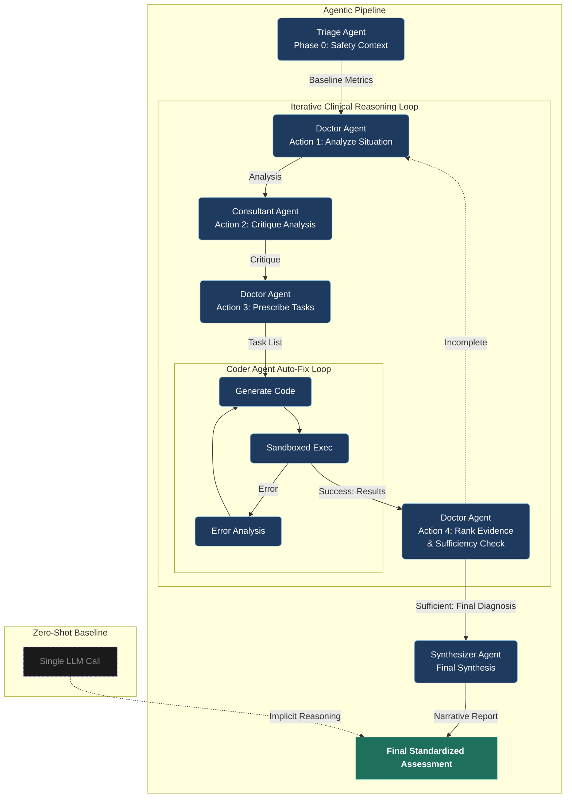
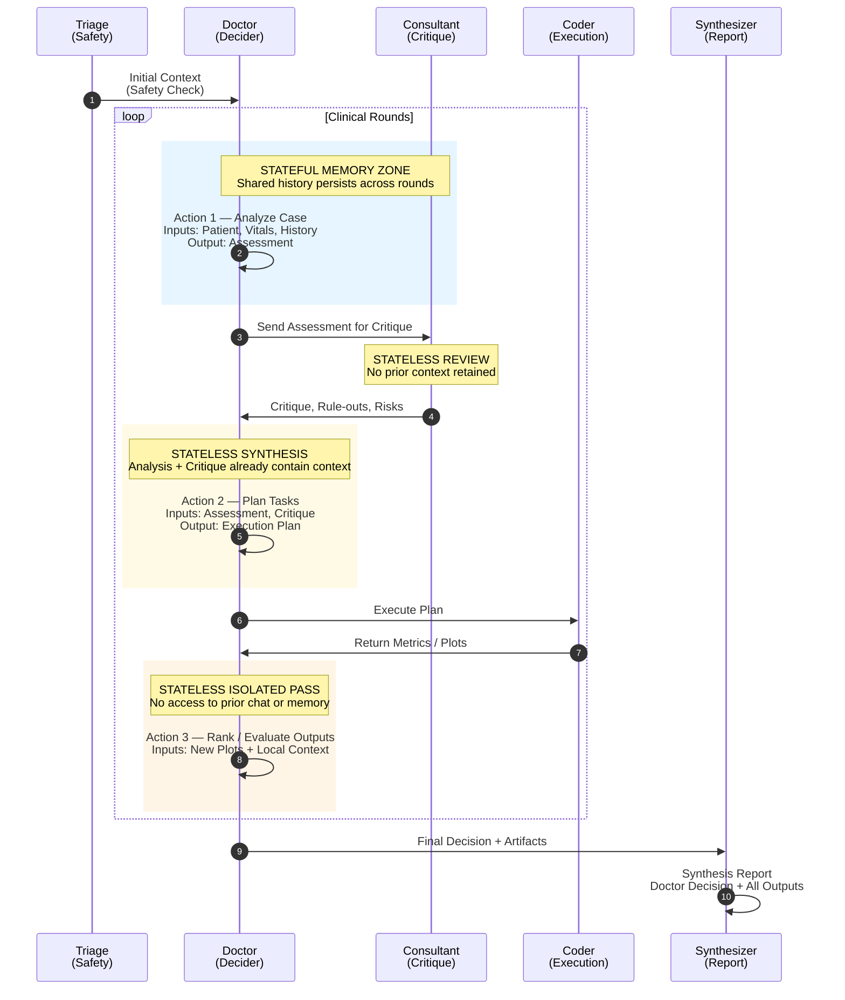

# XAI-Agent-Pulse

**Validation of Grounded Agentic Frameworks vs. Zero-Shot Baselines in Emergency Medicine**

Using the MC-MED (2025) dataset to validate whether multi-agent systems with code execution can improve clinical decision support and reduce the risk of arithmetic hallucinations.

## Quick Start

```bash
# Create virtual environment
python -m venv venv
source venv/bin/activate  # Windows: venv\Scripts\activate

# Install dependencies
pip install -r requirements.txt

# Ensure to have .env file configured as .env.example
cp .env.example .env # Adjust values as needed

# Create index with complete ground truth + 24h high-density vitals window
python src/data/create_index.py

# Run benchmark
# Default: runs with "gpt-5.2" on 20 samples
python run_benchmark.py

# Run specific models with more samples
python run_benchmark.py --models llama-4 --n 100

# Run full benchmark on ALL supported models
python run_benchmark.py --models all --n 50

# Launch expert survey app
streamlit run app/Survey.py
```

## Data Preparation

The benchmark requires a pre-computed index of visits with complete ground truth and high-quality vital sign data:
- **ESI** (non-null, valid 1-5)
- **LOS** (non-null ED length of stay)
- **Pain** (non-null pain score)
- **24-hour window with sufficient vitals** (≥30 samples each for HR, SBP, DBP, SpO2, RR, Temp within a continuous 24h period)

### Generate Benchmark Index

```bash
# Create index with complete ground truth + 24h high-density vitals window
python src/data/create_index.py
```

This creates `dataset/complete_benchmark_index.csv` containing:
- **CSN**: Visit identifier
- **window_start**: Start timestamp of the valid 24-hour window
- **window_end**: End timestamp of the valid 24-hour window

The index ensures data quality by:
1. Filtering visits with complete ground truth (ESI, LOS, Pain)
2. Identifying a 24-hour window with sufficient vital sign density (≥30 samples per vital)
3. Storing the exact window boundaries for consistent data loading
4. Outlier Filtering: Removing physiologically implausible values (artifacts) at load time

When loading data, `run_benchmark.py` automatically uses only the vitals within each stored 24-hour window, ensuring all models evaluate on the same high-quality time segment.

## Architecture

### System Overview



### Agent Interaction & State Models

The system architecture enforces specific memory constraints to prevent "tunnel vision" (confirmation bias) while maintaining coherence.

#### Interaction Flow


#### Context & Memory Matrix

| Agent | Action | Role | Memory Type | Context Description |
| :--- | :--- | :--- | :--- | :--- |
| **Doctor** | `analyze_situation` | Investigator | **Stateful** (Long-term) | Maintains a running "Chart". Remembers past hypotheses and evolved reasoning across all iterations. |
| **Consultant** | `critique_analysis` | Red Team | **Stateless** (Fresh Eyes) | Instantiated fresh for every critique. Does *not* see previous critiques. Acts as an unbiased second opinion every time. |
| **Doctor** | `prescribe_tasks` | Manager | **Stateless** (Synthesized) | Receives Doctor's analysis + Consultant's critique, which already synthesize all prior context. Full history is redundant. |
| **Doctor** | `rank_images` | Evidence Filter | **Stateless** (Isolated) | Isolated decision node. Reviews new images based *only* on the current Patient Summary and Analysis, without "noise" from the chat history. |

### Image Handling & Visual Evidence

The system manages visual evidence through a tiered selection process to ensure high-fidelity reporting without exceeding model context limits.

#### 1. The Ranking Phase (Doctor)
In each round, the **Doctor** reviews new plots generated by the Coder.
*   **Specialized Prompt**: Using the "Medical Editor" persona, the Doctor evaluates images for clinical relevance (1-10).
*   **Rank-Merge-Prune**: New image reviews are merged with existing ones. The list is then pruned to fit the model's `max_images` capacity, keeping only the most probative evidence.
*   **Decoupled Context**: Ranking is performed in an isolated pass to prevent chat history "noise" from biasing the evidence selection.

#### 2. The Selection Phase (Orchestrator)
During synthesis, the **Orchestrator** finalizes the list of images (Max 3) for the narrative report:
1.  **Triage Priority**: The personalized "Vitals Panel" (Triage) is always included as the primary baseline (Score 10).
2.  **Top-K Selection**: The remaining slots are filled with the highest-scoring images from the Doctor's ranked list.
3.  **Deduplication**: Filenames are strictly checked to prevent redundant charts in the final report.

#### 3. The Synthesis Phase (Synthesizer)
The **Synthesizer** receives the finalized list. Its role is to:
*   Incorporate findings from the images into the narrative assessment.
*   Maintain the chain of clinical evidence by citing specific visualizations that support the Doctor's diagnosis.

## Research Transparency

The benchmark generates hierarchical logs and results for clinical audit and reproducibility:

```bash
results/
├── full_benchmark_results.json # Final aggregated metrics for all models
│
└── <model_name>/                   # e.g., gemini-3-pro, gpt-5.2
    ├── full_results.json           # Detailed raw outputs for all visits
    ├── blinded_outputs.json        # Formatted for expert survey calibration
    ├── comparison_summary.md       # Markdown performance summary
    │   
    └── logs/                       # Research transparency traces
        ├── visits/                 # Detailed data per patient encounter
        │   └── <visit_id>/ 
        │       ├── llm_calls/      # Every raw API request/response
        │       ├── agent_steps/    # Internal state and agent metadata
        │       ├── figures/        # Clinical plots generated by Coder
        │       └── markdown_logs/  # Human-readable conversation traces
    
    # Translations (Auto-generated via scripts/translate_*.py)
    └── translated_results/
        └── <lang_code>/            # e.g., 'it', 'sq'
            └── <model_name>/
                ├── blinded_outputs.json
                └── coder_scripts/  # Translated plotting code
        └── experiments/            # Session metadata and full linked traces
```

### Blinding & Evaluation

To ensure unbiased clinical review, the system uses a standard suffix convention for `blinded_outputs.json`:

*   **Suffix `_A`**: Zero-Shot Baseline (Single-call approach)
*   **Suffix `_B`**: Agentic Pipeline (Multi-step clinical loop)
*   **Unblinding Key**: Use `full_results.json` in the same directory to map blinded IDs back to their respective approaches and detailed metrics.

## Project Structure

```
XAI-agent-pulse/
├── src/
│   ├── agents/
│   │   ├── doctor.py       # Attending Agent (Planning & Review)
│   │   ├── consultant.py   # Specialist Agent (Critique)
│   │   ├── coder.py        # Clinical Data Scientist (Code Execution)
│   │   ├── orchestrator.py # Coordinates Clinical Loop
│   │   ├── synthesizer.py  # Generates narrative
│   │   ├── triage.py       # Automated Phase 0 Protocol (Safety Context)
│   │   └── zero_shot.py    # Single LLM baseline
│   ├── data/               # MC-MED loaders
│   ├── experiments/        # Comparison experiments
│   ├── logging/            # Research transparency
│   ├── models/             # Model handlers
│   ├── prompts/            # Prompts templates and structures
│   └── utils/              # Utilities
├── app/
│   ├── pages/              # Streamlit pages
│   ├── auth.py             # Authentication
│   ├── survey_data.py      # Survey data
│   ├── survey.py           # Streamlit expert evaluation
│   └── utils.py            # Utilities
└── run_benchmark.py        # CLI entry point (Run experiments)
```

## License

Research use only. See MC-MED data use agreement.
